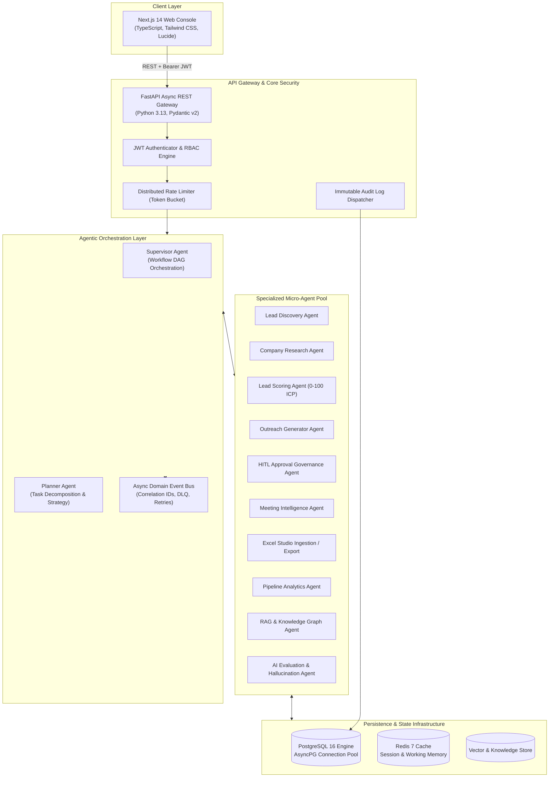
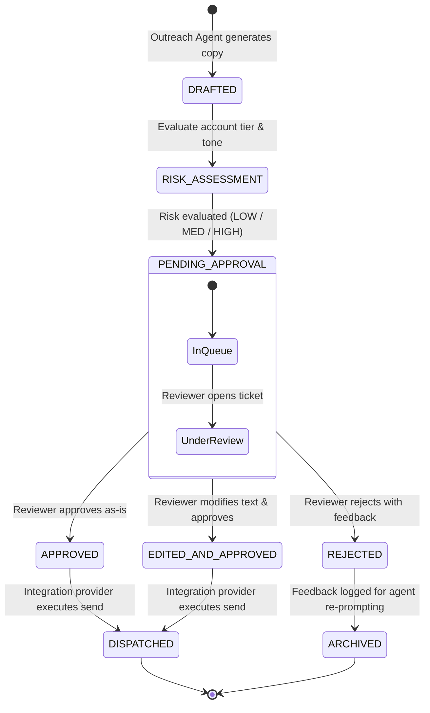
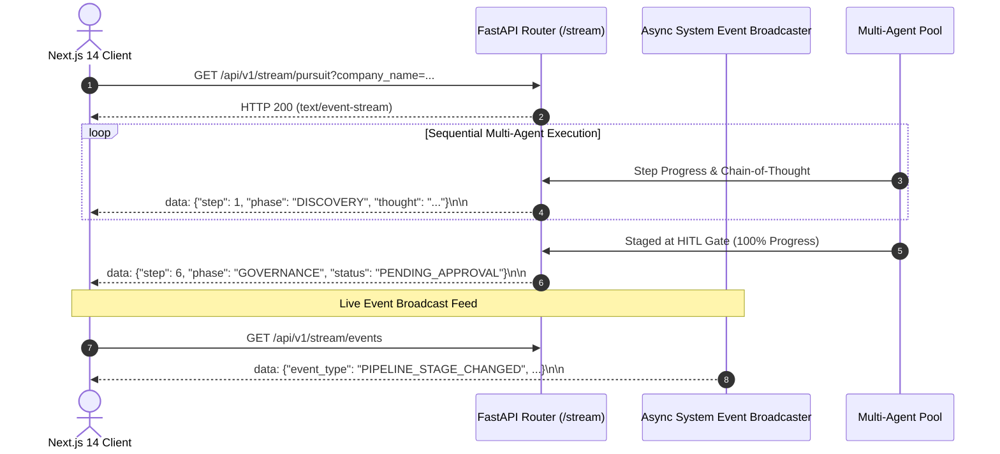
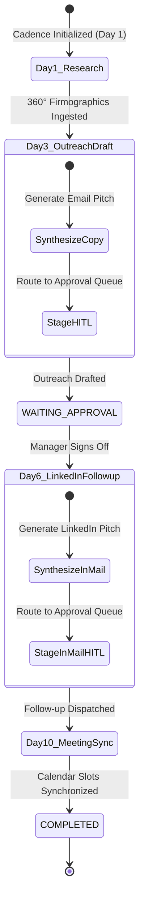

# 🏛️ Architecture & System Design — NEXORA

This document details the architectural blueprints, design patterns, event flows, and state machines underpinning the **NEXORA Agentic B2B Sales Orchestrator**.

---

## 1. High-Level Enterprise Topology



---

## 2. Core Architectural Principles

1. **AI Proposes, Humans Approve (HITL First)**:
   Autonomous agents possess read and preparation privileges. However, high-impact external actions (email dispatch, LinkedIn messages, calendar invitations, contract pricing) strictly pause at `PENDING_APPROVAL` status. The system cannot autonomously contact prospects without human sign-off.
2. **Row-Level Multi-Tenancy**:
   Every database model contains `tenant_id`. Every API request resolves `UserContext` from the JWT bearer token, and all database queries enforce row-level tenant filtering. Cross-tenant data bleed is impossible.
3. **Event-Driven Asynchronous Decoupling**:
   Agents communicate across a non-blocking domain event bus. Long-running tasks (e.g., firmographic web crawling or LLM synthesis) publish events such as `account.discovered`, `research.completed`, and `outreach.drafted` rather than holding synchronous HTTP connections.
4. **Resilience & Dead-Letter Queue (DLQ)**:
   If an agent encounters an error or malformed LLM response, the event bus retries with exponential backoff. If retry thresholds are exceeded, messages are diverted to a Dead-Letter Queue (DLQ) with correlation IDs for diagnostic playback without impacting the rest of the cluster.
5. **Zero External API Lock-In**:
   Full end-to-end functionality executes out of the box using realistic mock providers (`MockLLMProvider`, `MockWebResearchProvider`, `MockLinkedInProvider`, `MockEmailProvider`, `MockCalendarProvider`). Real Grok API keys or alternative LLMs can be toggled via environment settings with zero code changes.

---

## 3. Human-in-the-Loop (HITL) State Machine



---

## 4. Multi-Layer Memory Architecture

| Memory Tier | Technology | Lifetime | Purpose |
|---|---|---|---|
| **Working Memory** | Memory / Thread Context | Request / Task Lifetime | Stores intermediate prompt tokens, scratchpad calculations, and current DAG step status. |
| **Session Memory** | Redis 7 (`SETEX`) | Session (Configurable TTL) | Stores short-term dialogue context, active user sessions, and rate-limit token buckets. |
| **Long-Term Memory** | PostgreSQL 16 (AsyncPG) | Permanent (Transactional) | Accounts, Contacts, Pipeline Stages, Audit Logs, Approval Decisions, and Agent Metrics. |
| **Knowledge Memory** | Vector Embeddings / RAG | Permanent / Versioned | Company collateral, sales playbooks, objection-handling scripts, and buyer persona briefs. |

---

## 5. Domain Event Catalog

| Event Name | Producer | Consumers | Description |
|---|---|---|---|
| `account.ingested` | Excel / API | Research Agent, Scoring Agent | Triggered when new company record is created. |
| `research.completed` | Research Agent | Scoring Agent, Supervisor | Emitted when 360° firmographic profile is ready. |
| `lead.scored` | Scoring Agent | Supervisor, Outreach Agent | Emitted when ICP score and tier are calculated. |
| `outreach.drafted` | Outreach Agent | Approval Control Agent | Emitted when personalized copy is generated. |
| `approval.created` | Approval Control | Notification Service, Frontend | Signals new item in HITL approval center. |
| `outreach.approved` | Reviewer (UI) | Email / LinkedIn Provider | Triggered upon human sign-off; authorizes message send. |
| `outreach.sent` | Integration Provider | Pipeline Analytics, Audit Logger | Confirms successful external message dispatch. |
| `meeting.scheduled` | Meeting Intelligence | Calendar Provider, Analytics | Confirms calendar booking with prospect. |

---

## 6. Deterministic ICP Fit Scoring Formula

$$S_{\text{total}} = 0.30 \cdot S_{\text{industry}} + 0.25 \cdot S_{\text{revenue}} + 0.20 \cdot S_{\text{headcount}} + 0.15 \cdot S_{\text{intent}} + 0.10 \cdot S_{\text{tech}}$$

```
Tier 1 (High Fit):    Score >= 80  --> Immediate Multi-Channel Outreach
Tier 2 (Medium Fit):  Score 50-79  --> Nurture Campaign / Additional Research
Tier 3 (Low Fit):     Score < 50   --> Disqualified or Long-Term Tracking
```

---

## 7. Security & Compliance Architecture

- **JWT Authentication**: HS256 / RS256 token verification with user claims (`sub`, `email`, `role`, `tenant_id`).
- **Role Hierarchies**:
  - `ADMIN`: Full system configuration, user provisioning, audit inspection.
  - `REVIEWER`: Review, edit, approve, or reject outbound messages.
  - `SALES_REP`: Account discovery, pursuit initiation, contact creation.
- **Audit Immutability**: All actions generate an `AuditLog` row containing user ID, tenant ID, timestamp, IP, action, resource, and redacted payload parameters. Passwords and API secrets are automatically scrubbed before persistence.

---

## 8. Real-Time Streaming Architecture (Server-Sent Events)



---

## 9. Durable Cadence & Workflow Engine



