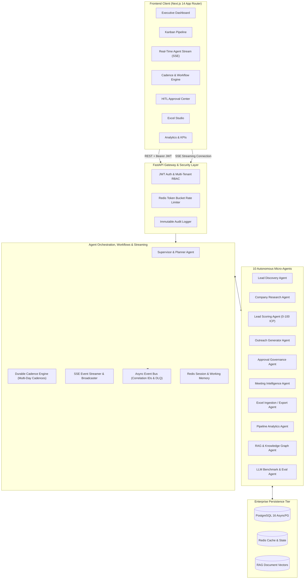
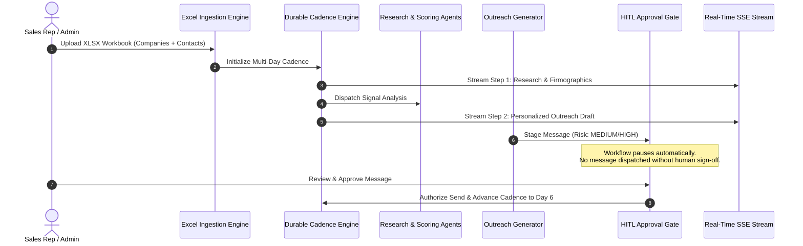

# ⚡ NEXORA — Agentic B2B Sales Orchestrator

[](https://python.org)
[](https://fastapi.tiangolo.com)
[](https://nextjs.org)
[](https://www.postgresql.org)
[](https://redis.io)
[](https://pytest.org)
[](https://pytest-cov.readthedocs.io)
[](https://github.com/Rajkumar7633/agentic-b2b-sales-orchestrator/actions)
[](LICENSE)

> **Enterprise-Grade Autonomous B2B Sales Pursuit & Revenue Engine** powered by 10 specialized Agentic AI Micro-services, Real-Time Server-Sent Events (SSE) Agent Streaming, Durable Multi-Touch Cadences, Human-in-the-Loop (HITL) Safety Gates, Multi-Provider LLMs, and Bi-directional Excel Data Ingestion.

---

## 📑 Table of Contents

- [Executive Overview](#-executive-overview)
- [System Architecture](#-system-architecture)
- [The 10 Autonomous AI Agents](#-the-10-autonomous-ai-agents)
- [⚡ Real-Time SSE Agent Streaming (Phase 1)](#-real-time-sse-agent-streaming-phase-1)
- [🔁 Durable Multi-Touch Cadence Engine (Phase 3)](#-durable-multi-touch-cadence-engine-phase-3)
- [Multi-Agent Orchestration Flow](#-multi-agent-orchestration-flow)
- [Human-in-the-Loop (HITL) Governance](#-human-in-the-loop-hitl-governance)
- [Deterministic Fit Scoring Algorithm](#-deterministic-fit-scoring-algorithm)
- [Bi-Directional Excel Ingestion Engine](#-bi-directional-excel-ingestion-engine)
- [Tech Stack](#-tech-stack)
- [Quick Start Guide](#-quick-start-guide)
  - [Prerequisites](#prerequisites)
  - [Backend Setup](#1-backend-setup-fastapi)
  - [Frontend Setup](#2-frontend-setup-nextjs-14)
  - [Docker Compose Deployment](#3-docker-compose-deployment)
- [Automated Verification & Test Suite](#-automated-verification--test-suite)
- [API Reference & Endpoints](#-api-reference--endpoints)
- [Security & Multi-Tenancy](#-security--multi-tenancy)
- [Project Structure](#-project-structure)
- [Documentation Index](#-documentation-index)

---

## 🌟 Executive Overview

**NEXORA** is a full-stack, enterprise-grade autonomous sales pursuit engine designed to replace brittle point-to-point prospecting tools with an **orchestrated multi-agent system**. 

Traditional SDR automation blasts generic outreach. NEXORA orchestrates specialized micro-agents that:
1. Detect accounts and intent signals.
2. Ingest structured enterprise data from custom Excel sheets without data loss.
3. Conduct deep firmographic & technographic research.
4. Calculate mathematical, deterministic ICP fit scores (0–100).
5. **Stream agent chain-of-thought tokens and tool execution live via Server-Sent Events (SSE)**.
6. **Execute durable, multi-day scheduled touchpoint cadences (Day 1 → Day 3 → Day 6 → Day 10)**.
7. **Enforce Human-in-the-Loop (HITL) approval gates** before any communication is dispatched.
8. Schedule meetings, process transcripts, and deliver real-time pipeline velocity analytics.

---

## 🏗 System Architecture



---

## ⚡ Real-Time SSE Agent Streaming (Phase 1)

Instead of relying on blocking requests or spinners, NEXORA features **native Server-Sent Events (SSE)** streaming token-by-token reasoning, tool executions, and state changes live to the browser:

- **Token & Step Progression**: Stream emissions with progress indicators (`15%` → `35%` → `55%` → `75%` → `90%` → `100%`).
- **Interactive Inspection**: Users can inspect exact prompt variables, tool outputs, and ICP fit calculations in real-time.
- **Firewall & Corporate Proxy Safe**: Operates over standard HTTP/2 text/event-stream connections without WebSocket proxy blocking.
- **Endpoint**: `GET /api/v1/stream/pursuit?company_name=...` and live event broadcast `GET /api/v1/stream/events`.

---

## 🔁 Durable Multi-Touch Cadence Engine (Phase 3)

NEXORA provides a **durable state-machine workflow engine** for scheduled, multi-day enterprise sales cadences:

```
[Day 1] Account Research & Firmographics  ──>  [Day 3] Executive Outreach Draft (HITL Gate)
                                                                 │
                                                                 ▼ (Human Approval)
[Day 10] Calendar Meeting Scheduling   <──  [Day 6] Multichannel LinkedIn InMail
```

- **Resilient State Persistence**: Workflow state, current step index, and execution logs persist durably in PostgreSQL. If the server restarts, workflows resume seamlessly.
- **Automated HITL Routing**: Outreach steps pause automatically at `WAITING_APPROVAL`, generating approval tickets before next execution.
- **Execution History & Audit Log**: Every executed touchpoint records exact timestamps, action types, channel details, and approval IDs.
- **Endpoints**: `POST /api/v1/workflows/cadence`, `POST /api/v1/workflows/cadence/{id}/step`, `POST /api/v1/workflows/cadence/{id}/pause`.

---

## 🤖 The 10 Autonomous AI Agents

| # | Agent Name | Core Responsibility | Output Artifact |
|---|---|---|---|
| 1 | **Supervisor Agent** | Decomposes high-level sales pursuits into coordinated multi-agent subtasks | Execution DAG, Agent Task Assignments |
| 2 | **Lead Discovery Agent** | Ingests raw accounts, searches decision makers, extracts intent signals | Enriched Lead Profiles, Discovered Contacts |
| 3 | **Company Research Agent** | Analyzes technographics, financial triggers, industry headwinds, news | 360° Account Intelligence Brief |
| 4 | **Lead Scoring Agent** | Computes deterministic ICP score (0–100) + LLM qualitative fit analysis | Tier Classification (`HIGH`, `MEDIUM`, `LOW`) |
| 5 | **Outreach Generator** | Synthesizes personalized multichannel copy (LinkedIn InMail, cold email) | Actionable Draft Messages |
| 6 | **Approval Control Agent** | Enforces governance, evaluates message risk, triggers HITL gates | Approval Tickets (`PENDING`, `APPROVED`, `REJECTED`) |
| 7 | **Meeting Intelligence** | Coordinates calendar slots, ingests call transcripts, extracts next steps | Structured Meeting Notes & Action Items |
| 8 | **Excel Studio Agent** | Parses, maps, validates, and syncs multi-sheet enterprise workbooks | Additive Ingestions & Two-Way Sync |
| 9 | **Pipeline Analytics** | Computes pipeline velocity, stage conversion, and bottleneck diagnostics | Real-Time Metrics & Recommendations |
| 10 | **AI Evaluation Agent** | Runs continuous benchmarks on LLM outputs (hallucination scoring, tone) | Quality Metrics & Model Evals |

---

## 🔄 Multi-Agent Orchestration Flow



---

## 🛡️ Human-in-the-Loop (HITL) Governance

In enterprise sales, unchecked AI hallucination or premature outreach can damage brand reputation. NEXORA implements strict **HITL safety gates**:

- **Automated Risk Triage**: Messages are classified as `LOW`, `MEDIUM`, or `HIGH` risk based on account tier, tone, and deal size.
- **Mandatory Approval Pause**: The outreach agent drafts messages and transitions the state to `PENDING_APPROVAL`.
- **Reviewer Action**: Authorized users (`ADMIN`, `REVIEWER`) can:
  - **Approve**: Dispatches the communication via configured provider (Mock, LinkedIn, Email).
  - **Edit & Approve**: Modifies copy inline; audit logs store both the AI draft and the human edits.
  - **Reject**: Halts the outreach and logs the reviewer's rejection reason.
- **Role Enforcement**: Sales reps cannot approve their own high-risk campaigns without managerial sign-off.

---

## 📐 Deterministic Fit Scoring Algorithm

Rather than relying on ungrounded LLM guesses, NEXORA evaluates accounts through a deterministic multi-factor algorithm combined with qualitative LLM reasoning:

$$\text{Score} = w_1 \cdot S_{\text{industry}} + w_2 \cdot S_{\text{size}} + w_3 \cdot S_{\text{revenue}} + w_4 \cdot S_{\text{intent}} + w_5 \cdot S_{\text{technographic}}$$

```python
# ICP Scoring Tiers
Score >= 80: TIER_1 (Immediate Multi-Channel Outreach)
Score 50-79: TIER_2 (Nurture & Technographic Research)
Score < 50:  TIER_3 (Low Priority / Disqualified)
```

Each score is saved with an explainable breakdown showing exact positive signals, negative deductions, and confidence ratings.

---

## 📊 Bi-Directional Excel Ingestion Engine

NEXORA features a custom Excel processing pipeline powered by `openpyxl`:
- **Additive Ingestion (Append-Only)**: Uploading new sheets *never* overwrites or drops existing account histories.
- **Deduplication**: Automatically detects duplicates by normalized company name and domain, skipping duplicates gracefully.
- **Multi-Sheet Support**: Ingests both `Companies` and `Contacts` sheets simultaneously, linking foreign keys automatically.
- **Validation & Error Isolation**: Malformed rows or missing columns produce structured warnings without crashing the batch.
- **Export Engine**: Export full live database snapshots back into styled XLSX workbooks at any time.

---

## 💻 Tech Stack

| Layer | Technologies |
|---|---|
| **Backend Framework** | **Python 3.13**, **FastAPI**, **Pydantic v2**, **Uvicorn** |
| **Frontend Framework** | **Next.js 14** (App Router), **TypeScript**, **Tailwind CSS**, **Lucide Icons** |
| **Real-Time Streaming** | **Server-Sent Events (SSE)**, StreamingResponse, Broadcast Queues |
| **Workflows & Cadences**| **Durable State Machine**, Scheduled Execution, Step Replay |
| **Database & ORM** | **PostgreSQL 16**, **SQLAlchemy 2.0 (Async)**, **AsyncPG**, **SQLite (Test Runner)** |
| **Cache & State** | **Redis 7**, Distributed Locks, Token Bucket Rate Limiting |
| **LLM Providers** | **xAI Grok**, **Groq (Llama-3.3-70B)**, **OpenAI**, **Anthropic**, **Mock Provider** |
| **Event Architecture** | **In-Memory Event Bus** with Dead-Letter Queues (DLQ) & Correlation IDs |
| **Testing & CI/CD** | **Pytest**, **Pytest-AsyncIO**, **Pytest-Cov** (147 tests, 83% coverage), GitHub Actions |

---

## 🚀 Quick Start Guide

### Prerequisites
- **Python 3.11+**
- **Node.js 18+** & npm
- **PostgreSQL 14+** (or Docker)
- **Redis** (optional; defaults to in-memory fallback)

---

### 1. Backend Setup (FastAPI)

```bash
# Clone the repository
git clone https://github.com/Rajkumar7633/agentic-b2b-sales-orchestrator.git
cd agentic-b2b-sales-orchestrator/backend

# Create and activate Python virtual environment
python3 -m venv .venv
source .venv/bin/activate  # On Windows: .venv\Scripts\activate

# Install dependencies
pip install -r requirements.txt

# Copy environment template
cp ../.env.example .env

# Initialize database schema and active agents
PYTHONPATH=. python app/seeds/seed.py

# Start FastAPI server
PYTHONPATH=. uvicorn app.main:app --host 0.0.0.0 --port 8000 --reload
```

The backend is now live at `http://localhost:8000`.  
Explore interactive OpenAPI docs at `http://localhost:8000/docs`.

---

### 2. Frontend Setup (Next.js 14)

In a separate terminal:

```bash
cd agentic-b2b-sales-orchestrator/frontend

# Install dependencies
npm install

# Start development dashboard
npm run dev -- --port 3000
```

Open `http://localhost:3000` in your browser.

---

### 3. Docker Compose Deployment

Launch the entire stack (FastAPI, Next.js, PostgreSQL, Redis) with a single command:

```bash
docker-compose up --build -d
```

To stop:
```bash
docker-compose down
```

---

## 🧪 Automated Verification & Test Suite

The repository includes a comprehensive automated test suite validating all agent loops, streaming endpoints, durable workflows, and security barriers:

```bash
cd backend
source .venv/bin/activate

# Run all 147 automated tests
PYTHONPATH=. pytest -v

# Run with test coverage report
PYTHONPATH=. pytest --cov=app --cov-report=term-missing
```

### Verified Test Results:
```
======================= 147 passed, 3 warnings in 8.14s =======================
TOTAL Coverage: 83%
```

| Test Category | Tests | Description |
|---|---|---|
| **Real-Time SSE Streaming** | 2 tests | Live agent reasoning stream, step progression, and broadcast channel |
| **Durable Cadence Workflows** | 3 tests | Multi-step lifecycle, HITL pause, resume, and full completion flow |
| **E2E Pursuit Workflow** | 3 tests | Health check, pursuit initiation, HITL approval, meeting sync |
| **Multi-Agent Registry** | 10 tests | Agent capability declaration, discovery, health status, metadata |
| **HITL Governance** | 11 tests | State transitions, RBAC enforcement, expiration, audit triggers |
| **Excel Ingestion / Export** | 17 tests | Multi-sheet parsing, deduplication, row-validation, export integrity |
| **Deterministic Scoring** | 5 tests | ICP algorithmic weights, boundary tests, tier classifications |
| **Analytics Engine** | 12 tests | KPI calculations, industry breakdown, stage distributions |
| **Security & RBAC** | 14 tests | JWT issuance, tenant isolation, role barriers (Admin, Reviewer, Rep) |
| **Event Bus & DLQ** | 4 tests | Async pub/sub, subscriber failure recovery, dead-letter routing |

---

## 🌐 API Reference & Endpoints

| Category | Method | Endpoint | Description |
|---|---|---|---|
| **Streaming** | `GET` | `/api/v1/stream/pursuit` | Server-Sent Events stream of live agent thoughts & execution |
| **Streaming** | `GET` | `/api/v1/stream/events` | SSE broadcast stream of live platform events |
| **Streaming** | `POST` | `/api/v1/stream/broadcast` | Broadcast custom event to connected browser sessions |
| **Workflows** | `POST` | `/api/v1/workflows/cadence` | Initialize new durable multi-touch sales cadence |
| **Workflows** | `GET` | `/api/v1/workflows/cadence` | List active, paused, and completed cadences |
| **Workflows** | `GET` | `/api/v1/workflows/cadence/{id}` | Retrieve cadence step configuration & execution history |
| **Workflows** | `POST` | `/api/v1/workflows/cadence/{id}/step` | Advance/execute next step in cadence |
| **Workflows** | `POST` | `/api/v1/workflows/cadence/{id}/pause` | Pause active cadence |
| **Workflows** | `POST` | `/api/v1/workflows/cadence/{id}/resume` | Resume paused cadence |
| **System** | `GET` | `/health` | Health status and uptime |
| **Auth** | `POST` | `/api/v1/auth/login` | Issue JWT access token |
| **Accounts** | `GET` | `/api/v1/accounts` | List accounts with pipeline stages |
| **Approvals** | `GET` | `/api/v1/approvals` | List pending HITL approval items |
| **Approvals** | `POST` | `/api/v1/approvals/{id}/approve` | Approve message dispatch |
| **Approvals** | `POST` | `/api/v1/approvals/{id}/reject` | Reject message dispatch |
| **Excel** | `POST` | `/api/v1/excel/import` | Execute additive workbook import |
| **Excel** | `GET` | `/api/v1/excel/export` | Export database state to XLSX |
| **Analytics** | `GET` | `/api/v1/analytics` | High-level metrics, KPIs & recommendations |
| **Agents** | `GET` | `/api/v1/agents` | Status and metrics for all 10 AI agents |
| **Meetings** | `GET` | `/api/v1/meetings` | Scheduled meetings and transcripts |
| **Audit** | `GET` | `/api/v1/audit-logs` | Immutable system activity audit log |

---

## 🔐 Security & Multi-Tenancy

- **Row-Level Tenant Isolation**: Every query and database transaction enforces `tenant_id` boundaries.
- **Role-Based Access Control (RBAC)**:
  - `ADMIN`: Full access to accounts, agents, config, and audit logs.
  - `REVIEWER`: Can review, edit, approve, or reject HITL outreach messages.
  - `SALES_REP`: Can browse accounts, contacts, and initiate pursuits (cannot approve outbound messages).
- **Data Sanitization & Secret Redaction**: Audit logs automatically redact sensitive fields (passwords, tokens, API keys) via regex filters before persisting.

---

## 📂 Project Structure

```
agentic-b2b-sales-orchestrator/
├── .github/workflows/          # CI/CD GitHub Actions pipelines
├── ARCHITECTURE.md             # System architecture & sequence diagrams
├── README.md                   # Project documentation & guide
├── docker-compose.yml          # Containerized multi-service orchestrator
├── docs/                       # 20+ Detailed technical specification specs
├── NEXORA_Pursuit_Engine_Dummy.xlsx # Sample dataset for instant testing
│
├── backend/                    # FastAPI Microservices Backend
│   ├── app/
│   │   ├── agents/             # 10 Autonomous AI Agents & Registry
│   │   ├── api/v1/             # REST API Endpoints & Route Handlers
│   │   │   ├── stream.py       # Phase 1: Real-Time SSE Agent Streaming
│   │   │   └── workflows.py    # Phase 3: Durable Cadence & Workflow API
│   │   ├── approvals/          # Human-in-the-Loop Approval Engine
│   │   ├── core/               # Security, Database, Streaming, Rate Limiting
│   │   ├── domain/             # SQLAlchemy Models & Pydantic Schemas
│   │   ├── evaluation/         # LLM Hallucination & Scoring Evaluator
│   │   ├── events/             # Domain Event Bus & Dead-Letter Queue
│   │   ├── excel/              # OpenPyXL Importer & Exporter
│   │   ├── integrations/       # LLM, LinkedIn, Email, Calendar Providers
│   │   ├── memory/             # Redis Session & Working Memory
│   │   └── workflows/          # Phase 3: Cadence Orchestration Engine
│   ├── tests/                  # Pytest automated test suite (147 tests)
│   ├── requirements.txt        # Python backend dependencies
│   └── pytest.ini              # Pytest configuration
│
└── frontend/                   # Next.js 14 Modern Web Console
    ├── src/
    │   ├── app/                # App Router Pages (17 Routes)
    │   │   ├── stream/         # Phase 1: Live Agent Reasoning & SSE Feed
    │   │   ├── workflows/      # Phase 3: Durable Cadence Management Console
    │   │   ├── accounts/       # Account Intelligence Scorecards
    │   │   ├── approvals/      # HITL Review & Approval Portal
    │   │   ├── excel/          # Workbook Ingestion Studio
    │   │   ├── pipeline/       # Dynamic Kanban Pursuit Board
    │   │   ├── analytics/      # Pipeline Velocity & KPIs
    │   │   └── ...             # Outreach, Meetings, Audit, Evaluation
    │   └── components/         # Reusable UI Components & Glassmorphism Sidebar
    ├── package.json            # Node.js dependencies
    └── tailwind.config.js      # Tailored styling tokens
```

---

## 📚 Documentation Index

Deep-dive engineering specs are available in the [`/docs`](docs/) directory:

- 🏗️ **[System Architecture](docs/ARCHITECTURE.md)** — Architectural patterns & topology
- 🤖 **[Agent Registry Specification](docs/AGENTS.md)** — Detailed specs for all 10 AI Agents
- 🔄 **[Agent Workflows](docs/AGENT_WORKFLOWS.md)** — State machines & transition logic
- ⚡ **[Event Bus Architecture](docs/EVENT_BUS.md)** — Async messaging, pub/sub topics & retries
- 🧠 **[Memory Systems](docs/MEMORY_ARCHITECTURE.md)** — Redis working memory & PostgreSQL state
- 🛡️ **[Human-in-the-Loop Engine](docs/HUMAN_IN_THE_LOOP.md)** — Approval policies & risk grading
- 🗄️ **[Data Model Specification](docs/DATA_MODEL.md)** — Relational entity schemas & diagrams
- 🌐 **[REST API Reference](docs/API.md)** — Complete OpenAPI specification
- 🔐 **[Security & RBAC](docs/SECURITY.md)** — Authentication, tokens, and multi-tenant isolation
- 🧪 **[Testing Architecture](docs/TESTING.md)** — Test plan & coverage breakdown

---

## 📄 License

This project is licensed under the **MIT License** — see the [LICENSE](LICENSE) file for details.

---

<p align="center">
  <b>Built for Enterprise Autonomous Sales Orchestration</b>
</p>
