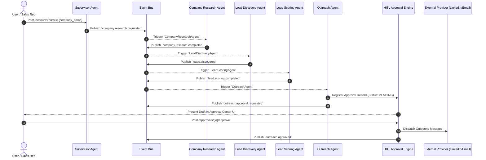

# NEXORA Agent Workflows (`docs/AGENT_WORKFLOWS.md`)

This document details the end-to-end multi-agent pursuit workflows, sequence diagrams, and state transitions in the **NEXORA Pursuit Engine**.

---

## 1. End-to-End Pursuit Execution Flow

```
Pursue Account Trigger (UI / Excel / API)
      │
      ▼
Supervisor Agent (`supervisor_agent`)
      │
      ▼
Planner Agent (`planner_agent`)
      │
      ▼
Company Research Agent (`company_research_agent`)
      │  └── (RAG Playbook Query + Project & Signal Discovery)
      ▼
Lead Discovery Agent (`lead_discovery_agent`)
      │  └── (Executive Decision Maker Mining)
      ▼
Lead Scoring Agent (`lead_scoring_agent`)
      │  └── (Deterministic ICP Score 0-100 Calculation)
      ▼
Outreach Agent (`outreach_agent`)
      │  └── (Personalized LinkedIn/Email Message Drafting)
      ▼
[ HUMAN APPROVAL GATE ] (`HITLApprovalEngine`)
      │
      ├──────────────────────────┐
      ▼                          ▼
 [ REJECTED ]              [ APPROVED ]
      │                          │
      ▼                          ▼
Feedback Loop              Dispatch via External Provider
Refine Draft               (LinkedIn / Email / Calendar)
                                 │
                                 ▼
                         Follow-up Agent (`followup_agent`)
                                 │
                                 ▼
                         Meeting Scheduler Agent (`meeting_scheduler_agent`)
                                 │
                                 ▼
                         CRM / Pipeline Agent (`crm_pipeline_agent`)
```

---

## 2. Event-Driven Messaging & Coupling

Rather than direct tight coupling between agents, communication is mediated via the asynchronous **`InMemoryEventBus`**:



---

## 3. HITL State Machine Transitions

```
[ PENDING ]  ───(User Approves)───►  [ APPROVED ]  ───►  Dispatch via Provider  ───►  [ DELIVERED ]
     │
     └───(User Rejects)────►  [ REJECTED ]  ───►  Agent Refines Draft
```

---

## 4. Pipeline Stage Lifecycle Transitions

1. `TARGET`: Account identified in workbook or API request.
2. `RESEARCHING`: Enriched with firmographic signals and verified projects.
3. `QUALIFIED`: Scored by Lead Scoring Agent (Fit score >= 50).
4. `OUTREACH_PENDING`: Draft created, locked in HITL Approval Gate.
5. `OUTREACH_SENT`: Approved by human, dispatched via provider.
6. `FOLLOW_UP_DUE`: Non-response interval active (5-7 day cadence).
7. `MEETING_BOOKED`: Prospect engaged, calendar meeting confirmed.
8. `WON`: Pursuit converted into active client contract.
